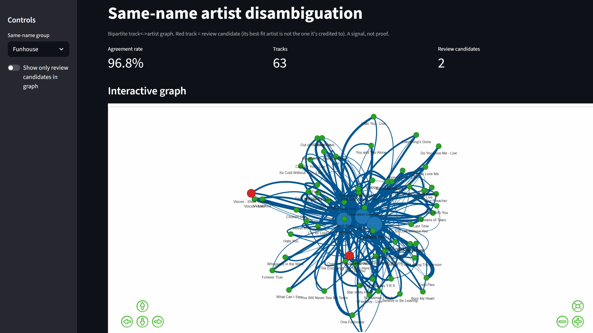

# Artist Name Disambiguation
Have you ever listened to music of your favourite artists online and had their radio on just to hear a completely unfamiliar song, album cover and vibe? I have and it has never been a good experience, and also a point of confusion. Sometimes its a simple mistake because 2 artists have the same name and maybe same song, but other times it may be more malicious than it seems to the eye. I wanted to solve this problem using data from Spotify, arguably the most well-known music streaming platform vulnerable to these problems. 

## Background and prior art

This project is informed by Spotify Research's "Which Witch? Artist name
disambiguation and catalog curation using audio and metadata" (Regan,
Hristova, Beguerisse Díaz; ISMIR 2023):
https://research.atspotify.com/2023/11/which-witch-artist-name-disambiguation-and-catalog-curation-using-audio-and-metadata

Spotify frames this as Named Entity Disambiguation and targets two error types:
**misattribution** (a release credited to the wrong same-name artist) and
**duplication** (one artist's discography split across multiple entries). Their
system combines audio embeddings with metadata in a random forest trained on
historical corrections, and keeps a human in the loop.

This project deliberately takes a **different, narrower path**:

- **Metadata only, no audio.** Spotify found audio dominates the misattribution
  signal and metadata adds ~2% precision, so a metadata-only tool is not trying
  to beat them on raw accuracy. Its edge is transparency and interactivity: every
  flag has a readable reason, not a black-box score.
- **No training labels.** Instead of a model trained on past corrections, this
  uses a transparent weighted similarity and a bipartite track↔artist graph.
- **Human-in-the-loop, by design.** Like Spotify's system, output is a review
  signal that directs attention, not an automated verdict.

## Future plans

- **Ground-truth labeling + evaluation.** Hand-label a small set
  (correct / misattributed / unsure) and report precision and recall, so the
  tool's flags are measured rather than assumed.
- **Interactive correction workbench.** Let a curator reassign a flagged track to
  the correct artist and mark it correct / misattributed / unsure directly in the
  UI — turning the app from read-only into a tool that fixes, not just flags.
- **Unify fixing and labeling.** Persist each in-UI correction to a corrections
  file (Postgres-swappable via the existing data-source seam) so every human fix
  also becomes ground-truth data that feeds the evaluation above.
- **Relocation suggestions.** Beyond flagging, suggest where a misattributed track
  should go — the harder "relocation" step Spotify highlights.


## Demo




## Data and credentials (read first)

- **No catalog data is included in this repo.** The `data/` directory is
  git-ignored. You regenerate it yourself from the Spotify Web API.
- Spotify API credentials live in a git-ignored `.env` file and are never
  committed. Create one in the project's parent directory:

  ```
  SPOTIFY_CLIENT_ID=your_client_id
  SPOTIFY_CLIENT_SECRET=your_client_secret
  ```

- Only Spotify **metadata** is stored, for identity/catalog analysis. Do not add
  audio to this project. Keeping catalog data out of version control respects
  Spotify's API terms on storing and redistributing their data.

## Setup

```bash
pip install -r requirements.txt
```

Requires Python 3.10+.

## Generate data (ingestion)

Ingestion is keyed on verified Spotify **artist IDs**, since display names are
not unique. Produces one CSV per same-name group at `data/spotify_tracks_<name>.csv`.

```bash
# Discover the exact-name artist IDs for a name (no ingestion)
python -m src.ingestion.ingestion --discover "WITCH"

# Ingest every exact-name artist returned for a display name
python -m src.ingestion.ingestion --artist-name "WITCH"

# Or ingest from the manually verified list in data/same_name_artists.json
python -m src.ingestion.ingestion --use-verified-config
```

A group is **analyzable only if its CSV has ≥ 2 distinct artist IDs** (a single
artist has nothing to compare against).

## Run the analysis

### Interactive app (recommended)

```bash
streamlit run app.py
```

Opens in your browser. Pick a same-name group, see the **agreement rate**,
explore the interactive graph (pan / zoom / hover), filter to **review
candidates**, and click a track to inspect its per-artist scores. Big dots are
artists; small dots are tracks (red = review candidate, green = agrees).

### Command line

```bash
# Graph-based agreement report + review candidates
python -m src.analysis.outliers data/spotify_tracks_WITCH.csv --graph

# Also print the original threshold-based flags for comparison
python -m src.analysis.outliers data/spotify_tracks_WITCH.csv --graph --compare

# Original threshold mode (default, no --graph)
python -m src.analysis.outliers data/spotify_tracks_WITCH.csv
```

## How it works

| Stage | File | What it does |
|-------|------|--------------|
| Ingestion | `src/ingestion/ingestion.py` | Pull catalog metadata from Spotify, keyed by artist ID |
| Data seam | `src/analysis/data_source.py` | Single load point (CSV today, swappable for a database later) |
| Features | `src/analysis/features.py` | Interpretable metadata blocks (numeric, album, text, collaborators), leakage-aware |
| Profiles | `src/analysis/profiles.py` | Per-artist centroids and summary stats |
| Scoring | `src/analysis/scoring.py` | Track-vs-artist compatibility; full score matrix |
| Graph | `src/analysis/graph.py` | Bipartite track↔artist graph + agreement metric |
| CLI | `src/analysis/outliers.py` | Threshold mode (default) and `--graph` mode |
| App | `app.py`, `src/app_core.py` | Interactive Streamlit UI |

**Agreement metric:** a track "agrees" if its highest-scoring artist is the one
it is credited to; disagreements are review candidates, ranked by how much a
rival artist fit better (the score gap).

## Tests

```bash
python -m pytest tests -q -p no:importnb
```

(The `-p no:importnb` flag disables an unrelated third-party pytest plugin that
otherwise crashes collection in this environment.)

## Status and next steps

Tier 1 (bipartite graph + agreement metric + interactive UI) is complete. Known
limitations and planned work:

- **No ground truth.** The agreement metric is a consistency signal. The highest-
  value next step is a small hand-labeled set (correct / misattributed / unsure)
  to measure precision and recall.
- **Small catalogs.** Ingestion samples a few albums per artist; flagged gaps are
  often borderline.
- **Tier 2 (planned):** add track↔track edges (shared album / collaborators) and
  community detection for richer structure.

## License

Released under the [MIT License](LICENSE). This covers the project's code only,
not Spotify's data or API terms.
